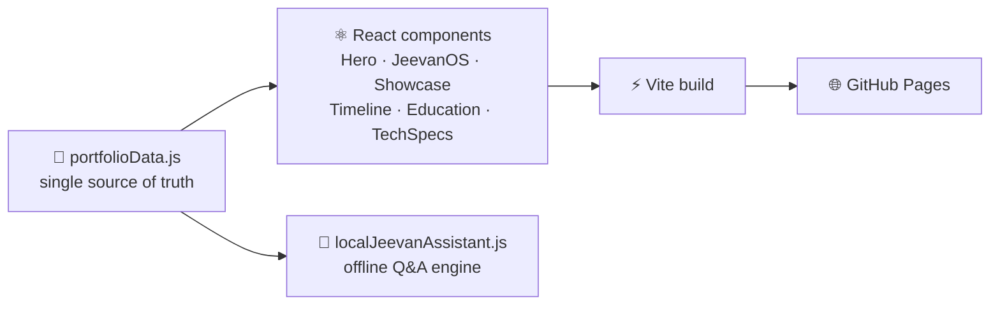

<p align="center">
  
</p>

<p align="center">
  <a href="https://jeevanjyot55.github.io"></a>
</p>

<p align="center">
  
  
  
  
</p>

<p align="center">
  <b>Not just a résumé page. An interactive portfolio with its own control center, a terminal you can ask questions,<br/>and a playground to explore, all built from scratch in React.</b>
</p>

---

## ✨ What's Inside

| Section | What it does |
|---|---|
| 🦸 **Hero** | Intro, résumé download and social links |
| 🖥️ **JeevanOS** | A mini desktop "control center" with a live appearance theme and accent-color picker that restyles the whole site |
| 💬 **Ask-Me Terminal** | Type a question about my experience, projects or skills and get an answer, powered by a local, rule-based assistant with no API calls and no data leaving your browser |
| 🚀 **Project Showcase** | Cards for each project with tech stacks, highlights and source links |
| 🧭 **Timeline** | Experience and milestones, including my Software Engineering internship at Google |
| 🎓 **Education** | UW–Madison, CS + Economics, and coursework |
| 🛠️ **Tech Specs** | Languages, frameworks and tools, organized like a spec sheet |
| 🎮 **Fun Playground** | Interactive extras (with confetti 🎉) |

---

## 🏗️ How It's Built



- **Data-driven:** every project, role and skill lives in one `portfolioData.js` file, so updating the site means editing data, not markup
- **Zero backend:** the Q&A assistant runs fully in the browser
- **Lightweight:** React + Vite with hand-written CSS and only a few small dependencies (`lucide-react` icons, `canvas-confetti`)

---

## 🚀 Run Locally

```bash
git clone https://github.com/JeevanJyot55/JeevanJyot55.github.io.git
cd JeevanJyot55.github.io
npm install
npm run dev
```

### Deploy
```bash
npm run deploy     # builds with Vite and publishes /dist to GitHub Pages
```

---

## 📁 Structure

```
src/
├── components/        # Hero, InteractiveOS, Showcase, Timeline, Education,
│                      # TechSpecs, FunPlayground, Navbar, Footer
├── utils/
│   └── localJeevanAssistant.js   # Offline Q&A engine
├── portfolioData.js   # All site content in one place
└── App.jsx
```

---

<p align="center">
  Built by <a href="https://github.com/JeevanJyot55"><b>Jeevan Jyot Singh</b></a> · <a href="https://www.linkedin.com/in/jeevanjyotsingh">LinkedIn</a> · <a href="https://jeevanjyot55.github.io">Portfolio</a>
</p>
